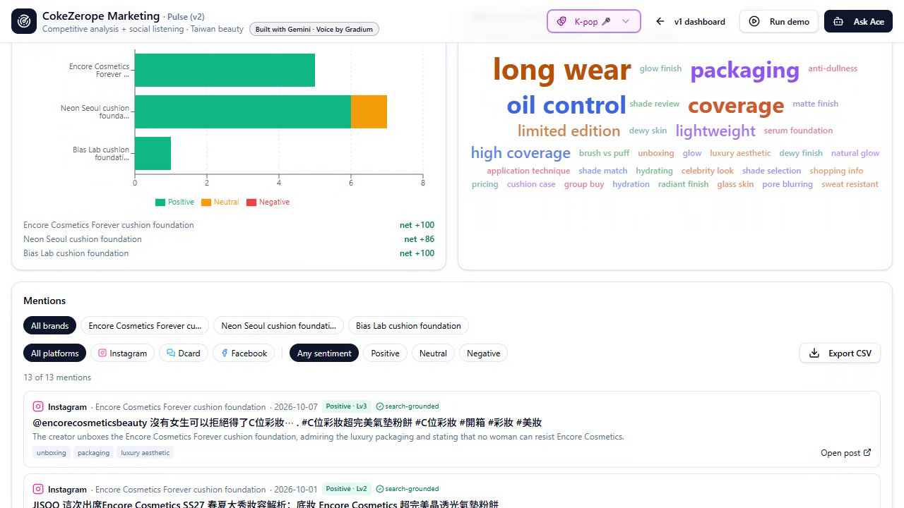
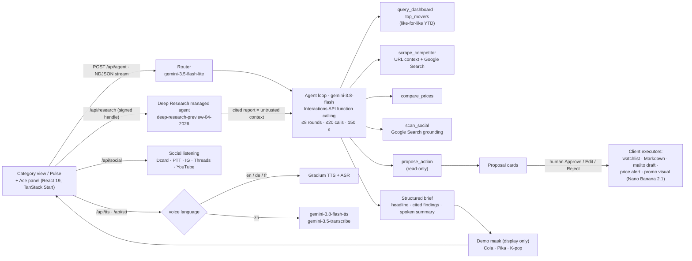

# CokeZerope Marketing

> **Ace, an AI marketing analyst for consumer brands in Taiwan (demo: Coke Zero vs Pepsi Zero and Sprite Zero).** It explains why sales moved, checks competitor prices and social buzz live, and proposes this week's actions. A human approves every one. Gemini does the reasoning, Gradium does the voice.

▶️ **Demo video: https://youtu.be/HPQ6d0eSJB8**

Built at **{Tech: Europe} Agentic AI Hack Zürich, 10 Oct 2026** (Google DeepMind × {Tech: Europe}). See [Built at the hackathon](#built-at-the-hackathon--disclosure).

|                         |                                                                                                                      |
| ----------------------- | -------------------------------------------------------------------------------------------------------------------- |
| **Category view** (`/`) | Sales dashboard + Ace for the category manager (EN / 中文)                                                           |
| **Pulse** (`/v2`)       | Competitive analysis + social listening for the marketing team (EN)                                                  |
| **Demo mask**           | One switch re-skins every brand on screen as **Cola 🥤**, **Pika ⚡** or **K-pop 🎤**, for safe demos and recordings |

All sales data in this repo is **synthetic** (see [Data and privacy](#data-and-privacy)).

---

## Problem

Every Monday, a make-up category or marketing manager in Taiwan has to answer two questions:

1. **Why did sales move?** By line, product, value, units and unit price.
2. **What do we do about competitors?** Their prices and promotions on momo, Sephora and Watsons, and what consumers say on Dcard, PTT, Instagram and Threads.

Today that takes hours of spreadsheets, browser tabs and screenshots, and the numbers are easy to misread. The demo dashboard's headline says the hero line **AURUM GOLD is −55 % vs 2025**, but 2026 only has half a year of data.

## Solution

**Ace** is an agent that does the analysis rather than just chatting:

- **Plans:** a Gemini Flash-Lite router classifies the question and writes a 2–4 step plan.
- **Uses tools in a loop:** Gemini 3.8 Flash runs function calling over the **Interactions API** (≤8 rounds, ≤20 tool calls, server-side state). The tools:
  - like-for-like sales queries and top movers
  - live competitor scraping (URL context + Google Search)
  - price-gap comparison
  - social listening (Google Search grounding)
- **Cites everything:** every finding links to the exact sales row or social post. Citation ids are validated server-side, so the model can't make them up.
- **Proposes, never executes:** watchlist, Markdown brief, team email draft, price-gap alert and promo-visual draft all wait for a human **Approve**, **Edit** or **Reject**. Every decision is logged.
- **Talks:** push-to-talk questions and a ≤60 s spoken brief via **Gradium** (EN/DE/FR), or Gemini TTS/STT (中文).
- **Researches in the background:** the **Gemini Deep Research** managed agent produces a cited 90-day market report that Ace can use as context.

**Before vs after.** Before: "AURUM GOLD −55 %", three browser tabs and a spreadsheet. After, in about 2 minutes: a cited brief saying the line is **+5.1 % like-for-like** and the "decline" is a data-coverage artifact. Cushion Foundation is **+243 %** while Silk Veil is **−46 %**. Rival cushion promotions on momo and what consumers praise on Dcard come with it, plus proposals ready to approve.

## Demo

- 1:47 demo video: **[youtu.be/HPQ6d0eSJB8](https://youtu.be/HPQ6d0eSJB8)**. Description with timestamps: [`docs/YOUTUBE_DESCRIPTION.md`](docs/YOUTUBE_DESCRIPTION.md)
- How the video was made: a real recorded run, **Gradium** narration, **Gemini Lyria 3.5** music and burned-in subtitles. See [`tools/demo-video/`](tools/demo-video/README.md).
- Video script: [`docs/VIDEO_SCRIPT.md`](docs/VIDEO_SCRIPT.md). 5-minute pitch: [`docs/PITCH_5MIN.md`](docs/PITCH_5MIN.md)



## Architecture



The full design (prompts, tools, data flow, error handling, demo mask, synthetic data) is in [`docs/TECHNICAL.md`](docs/TECHNICAL.md).

## Partner technology: where and how

| Partner                                                               | What it does here                                                                                               | Where in the code                                                                                                                                          |
| --------------------------------------------------------------------- | --------------------------------------------------------------------------------------------------------------- | ---------------------------------------------------------------------------------------------------------------------------------------------------------- |
| **Google DeepMind · Gemini** (Interactions API, `@google/genai` 2.28) | Router + plan (`gemini-3.5-flash-lite`)                                                                         | [`src/lib/agent/agent.server.ts`](src/lib/agent/agent.server.ts) `routeQuestion`                                                                           |
|                                                                       | Agent tool loop: function calling, `previous_interaction_id` state, structured final brief (`gemini-3.8-flash`) | [`src/lib/agent/agent.server.ts`](src/lib/agent/agent.server.ts) `runAgent`                                                                                |
|                                                                       | Competitor scraping: `url_context` + `google_search` tools with structured output                               | [`src/lib/competitor.server.ts`](src/lib/competitor.server.ts)                                                                                             |
|                                                                       | Social listening: `google_search` grounding, one search per brand in parallel                                   | [`src/lib/social/social.server.ts`](src/lib/social/social.server.ts)                                                                                       |
|                                                                       | **Managed agent:** Deep Research in the background, polled and cancellable                                      | [`src/routes/api/research.ts`](src/routes/api/research.ts)                                                                                                 |
|                                                                       | Mandarin TTS (`gemini-3.8-flash-tts`), STT (`gemini-3.5-transcribe`), and transcript / voice rewrite            | [`src/lib/ai/voice.server.ts`](src/lib/ai/voice.server.ts)                                                                                                 |
|                                                                       | Promo-visual drafts (`gemini-nano-banana-2.1`), only after Approve                                              | [`src/routes/api/image.ts`](src/routes/api/image.ts)                                                                                                       |
|                                                                       | Competitor screenshot understanding (image input to the agent)                                                  | [`src/components/agent/useAce.ts`](src/components/agent/useAce.ts) → `agent.server.ts`                                                                     |
|                                                                       | Demo-video soundtrack (`lyria-3.5`)                                                                             | [`tools/demo-video/music.cjs`](tools/demo-video/music.cjs)                                                                                                 |
| **Gradium** (REST TTS + ASR)                                          | Read-aloud of the spoken brief (voice Emma `YTpq7expH9539ERJ`, plus DE/FR flagship voices)                      | [`src/lib/ai/gradium.server.ts`](src/lib/ai/gradium.server.ts) `gradiumTts` → [`src/routes/api/tts.ts`](src/routes/api/tts.ts)                             |
|                                                                       | Push-to-talk speech-to-text: 24 kHz 16-bit WAV encoded in the browser, NDJSON response                          | `gradiumStt` → [`src/routes/api/stt.ts`](src/routes/api/stt.ts), mic in [`src/components/agent/VoiceControls.tsx`](src/components/agent/VoiceControls.tsx) |
|                                                                       | Demo-video narration                                                                                            | [`tools/demo-video/`](tools/demo-video/README.md)                                                                                                          |
| **Entire**                                                            | Session capture for agent work, linked to commits (Claude Code hooks); repo onboarded on entire.io              | [`.entire/settings.json`](.entire/settings.json), [`.claude/settings.json`](.claude/settings.json)                                                         |

## Tech stack

- [TanStack Start](https://tanstack.com/start) (React 19, file routes, server routes, `createServerFn`) on [Vite 7](https://vite.dev); builds for Cloudflare Workers via Nitro
- [Tailwind CSS 4](https://tailwindcss.com) + [shadcn/ui](https://ui.shadcn.com) (Radix) + [lucide](https://lucide.dev) icons
- [Recharts](https://recharts.org) for charts; [zod](https://zod.dev) for request validation; [SheetJS](https://sheetjs.com) for Excel upload
- [`@google/genai`](https://www.npmjs.com/package/@google/genai) for the [Gemini Interactions API](https://ai.google.dev/gemini-api/docs/interactions)
- [Gradium API](https://docs.gradium.ai) (REST `/post/speech/tts`, `/post/speech/asr`)
- [Entire CLI](https://entire.io) for session capture
- [Bun](https://bun.sh) as package manager; ESLint + Prettier
- Built with [Claude Code](https://claude.com/claude-code)

## Setup and install

Requirements: Node 20+ and [Bun](https://bun.sh) 1.x (`npm i -g bun`), a Gemini API key, and a Gradium API key.

```bash
git clone https://github.com/Grace9393/cokezerope-marketing.git
cd cokezerope-marketing
bun install
cp .env.example .env        # then put your keys in .env
bun run dev                 # http://localhost:8080
```

`.env` (server-only, git-ignored, never `VITE_`-prefixed):

```dotenv
GEMINI_API_KEY=your-gemini-key
GRADIUM_API_KEY=your-gradium-key
```

Other commands: `bun run build` (Cloudflare Workers bundle in `.output/`), `bun run lint`, and `python tools/synthetic-data/generate.py` (regenerates the synthetic dataset).

## How to run the demo

1. **Category view** (`/`): click **Run demo / 執行示範**. Ace queries the sales data like-for-like, scrapes a live momo search page, compares prices, writes a cited brief, proposes actions and reads the brief aloud. Click a citation chip to jump to the highlighted table row, then **Approve** a proposal.
2. **Pulse** (`/v2`): click **Run demo**. That runs a live 3-brand social scan (about 1–2 min; the default targets are **Coca-Cola Zero vs Pepsi Zero vs Sprite Zero**, and you can type any brands), then Ace in marketing mode, a cited brief and a **Gradium** read-aloud. Click a `SOCIAL ›` citation to jump to the post.
3. **Demo mask:** pick **Cola 🥤**, **Pika ⚡** or **K-pop 🎤** in the header, or add `?mask=pika` to the URL. Every brand and product name on screen is re-skinned, while Ace keeps working on the real names.
4. **Voice:** hold the mic button and ask a question. The transcript lands in the input box for review before sending.
5. **Deep Research:** click **Deep research** on the competitor card. The background job takes about 10–25 min and returns a cited report.

Tip for live demos: run the Pulse scan once before presenting, so the page is already filled.

## API and agent flow

| Endpoint           | Method     | Body / query                                                                                                                      | Returns                                                                           | Backed by                                                            |
| ------------------ | ---------- | --------------------------------------------------------------------------------------------------------------------------------- | --------------------------------------------------------------------------------- | -------------------------------------------------------------------- |
| `/api/agent`       | POST       | `{question, lang, metric, year, selectedCategory, entries, history, image?, watchlist?, researchContext?, mode?, socialContext?}` | NDJSON stream of `plan`, `tool_call`, `tool_result`, `proposal`, `final`, `error` | Gemini router + agent loop                                           |
| `/api/social`      | POST       | `{brands[1..4], platforms[], days}`                                                                                               | `SocialScan` (mentions, per-brand stats, topics)                                  | Gemini + Google Search                                               |
| `/api/tts`         | POST       | `{text, lang: en\|de\|fr\|zh, sourceLang?, voiceId?}`                                                                             | `audio/wav`                                                                       | Gradium (en/de/fr), Gemini TTS (zh)                                  |
| `/api/stt`         | POST       | `?lang=…&vocab=…`, WAV body                                                                                                       | `{text}`                                                                          | Gradium ASR (en/de/fr), Gemini transcribe (zh) + Flash-Lite clean-up |
| `/api/research`    | POST / GET | `{action:"start", topic, lang}` · `{action:"cancel", id}` · `?id=`                                                                | `{id (signed), status, progress[], report, sources[]}`                            | Gemini Deep Research managed agent                                   |
| `/api/image`       | POST       | `{title, details, lang}`                                                                                                          | `{image (base64), mimeType}`                                                      | Gemini Nano Banana 2.1                                               |
| `scrapeCompetitor` | server fn  | `{url}` (allowlisted retailers)                                                                                                   | `CompetitorResult`                                                                | Gemini URL context + Google Search                                   |

Agent tools (all read-only): `query_dashboard`, `top_movers`, `scrape_competitor`, `compare_prices`, `scan_social`, `propose_action`. Details are in [`docs/TECHNICAL.md`](docs/TECHNICAL.md).

## Safety, cost and human control

- **The agent cannot act.** `propose_action` only returns an object. Executors run in the browser, and only from an **Approve** click (`src/components/agent/useApproveProposal.ts`). Emails open as `mailto:` drafts and are never sent.
- **Budgets:** per question, at most 20 tool calls, 2 deduplicated scrapes, 1 social scan and a 150 s deadline. Every AI route also has a per-IP rate limit.
- **Untrusted input:** scraped pages, screenshots, social posts and research reports are framed as untrusted data, and their delimiters are escaped. Watchlist URLs must pass a retailer allowlist. Deep Research handles are HMAC-signed.
- **No invented numbers:** evidence ids in the brief are dropped unless a tool actually returned them. Social mentions are labelled _search-grounded_ vs _unverified link_.
- **Secrets** live only in server env (`.env`, `.env.example`). They're read per request, never at module scope.

## Data and privacy

- **Sales data is synthetic.** `src/data/snapshot.json` is generated by [`tools/synthetic-data/generate.py`](tools/synthetic-data/generate.py). It uses a fictional house brand ("Maison Aurelle", lines like AURUM GOLD and Stellaria) and seeded random numbers. No real company's sales are in this repo.
- **Live data:** competitor prices and social posts are fetched live from public web pages through Gemini.
- **Demo mask:** re-skins all brand names on screen, for recording or presenting without showing any brand. It's display-only, so the analysis is unchanged.

## Limitations and next steps

- Social listening uses Google Search grounding, not platform APIs. Coverage is a sample of indexed posts (about 15–20 per scan), and snippets are Gemini paraphrases. Next step: official platform APIs, and scheduled scans with alerts on negative-sentiment spikes.
- The watchlist, activity log and alerts live in browser `localStorage`. Next step: server persistence and team sharing.
- Retailer pages rendered with JavaScript sometimes need the Google Search fallback, and a scrape takes about 40 s.
- Deep Research takes about 10–25 min, so it's best started early.

## Built at the hackathon · disclosure

- **Created at {Tech: Europe} Agentic AI Hack Zürich on 10 Oct 2026.** The public history starts with a clean commit of today's work.
  - The build itself happened earlier the same day in a private local repository: 15 commits from 12:44 to 15:22 CEST.
  - That history isn't published because its boilerplate commit contained confidential data. Its timeline is listed in [`docs/BUILD_LOG.md`](docs/BUILD_LOG.md).
- **Boilerplate (pre-existing):** a Lovable-generated dashboard shell (KPI cards, charts, category drill-down, detail table, Excel parser, EN/中文 i18n). The agent lives in it.
- **Built today:**
  - the Ace agent: router, Interactions API tool loop, tools, cited brief, evidence validation, streaming timeline
  - human approval and the activity log
  - Gradium and Gemini voice
  - Deep Research
  - Gemini-only competitor scraping
  - social listening and the Pulse page
  - the demo mask
  - the synthetic dataset
  - all `/api/*` routes, security guards, the demo-video pipeline and the docs
- **Ideas reused, no code copied:** the Pulse sentiment levels, platform list, word cloud and CSV export follow the design of an earlier Lovable project ("Social Pulse Insights"). They were rewritten today for Gemini data.

Built with Claude Code. Agent sessions are captured with Entire.
